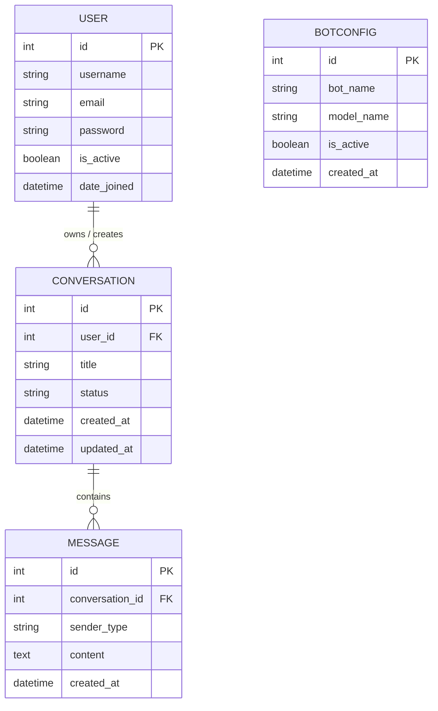

# 🤖 Django Assistant – Complete Chatbot Application

A modern, robust, beginner-friendly Django full-stack chatbot application built for technical assignments, portfolio demonstrations, and local development. It features built-in user authentication, session-protected routes, REST API endpoints powered by Django REST Framework (DRF), and a rule-based AI assistant engine that operates completely locally without requiring external API keys or an active internet connection.

---

## 📋 Table of Contents

1. [Project Overview](#project-overview)
2. [Technology Stack](#technology-stack)
3. [Folder Structure](#folder-structure)
4. [Entity-Relationship (ER) Diagram](#entity-relationship-er-diagram)
5. [Installation & Setup](#installation--setup)
   - [Prerequisites](#prerequisites)
   - [Virtual Environment Creation](#virtual-environment-creation)
   - [Dependency Installation](#dependency-installation)
   - [Environment Configuration](#environment-configuration)
   - [Database Migrations](#database-migrations)
   - [Creating a Superuser](#creating-a-superuser)
   - [Running the Development Server](#running-the-development-server)
6. [Application Pages & URL Mapping](#application-pages--url-mapping)
7. [REST API Endpoints](#rest-api-endpoints)
8. [Rule-Based Chatbot Engine](#rule-based-chatbot-engine)
9. [Automated Testing](#automated-testing)
10. [Django Admin Portal](#django-admin-portal)
11. [Troubleshooting & FAQ](#troubleshooting--faq)

---

## 🌟 Project Overview

**Django Assistant** is designed as a self-contained conversational platform where users can:
- **Register & Sign In**: Secure session-based authentication using Django's built-in `User` model.
- **Manage Multiple Chat Threads**: Create new conversations, switch between previous discussions, and browse history from an interactive sidebar.
- **Local Rule-Based Responses**: Instantly answers queries about Python, Django architecture, models, ORM, databases, and general troubleshooting using keyword pattern matching.
- **Zero Third-Party AI API Dependency**: Runs 100% offline once Python packages are installed, with no quota limits, rate limits, or billing requirements.
- **Modern Responsive UI**: Built with pure semantic HTML5, CSS3 flexbox/grid layout, and vanilla JavaScript (Fetch API with CSRF token handling and `textContent` XSS mitigation).

---

## 🛠️ Technology Stack

- **Backend**: Python 3.11+, Django 5.x
- **Web APIs**: Django REST Framework (DRF)
- **Database**: SQLite3 (default zero-configuration file database)
- **Frontend**: HTML5, CSS3 (Modern dark-slate theme), Vanilla JavaScript (ES6+)
- **Authentication**: Django built-in Session & Authentication Framework
- **Environment Management**: `python-dotenv`

> **Note**: No React, Angular, Node.js, or external AI API keys are required.

---

## 📁 Folder Structure

```text
chat/
│
├── manage.py                   # Django CLI management script
├── requirements.txt            # Project dependencies list
├── README.md                   # Complete documentation & guide
├── .env.example                # Example environment variable file
├── .env                        # Local active environment configuration
├── .gitignore                  # Git untracked files specification
│
├── config/                     # Django project configuration package
│   ├── __init__.py
│   ├── settings.py             # Project settings (Apps, DB, Auth, DRF)
│   ├── urls.py                 # Root URL configuration
│   ├── asgi.py                 # ASGI configuration for async servers
│   └── wsgi.py                 # WSGI configuration for production deployment
│
├── chatbot/                    # Chatbot Django Application
│   ├── __init__.py
│   ├── admin.py                # Model registration with Django Admin
│   ├── apps.py                 # App configuration
│   ├── models.py               # Database schemas (Conversation, Message, BotConfig)
│   ├── serializers.py          # DRF serializers for API responses & validation
│   ├── views.py                # Web views and REST API controllers
│   ├── urls.py                 # App routing endpoints
│   ├── chatbot_service.py      # Rule-based pattern matching engine
│   ├── tests.py                # 22 comprehensive automated tests
│   └── migrations/             # Database migration history
│       ├── __init__.py
│       └── 0001_initial.py
│
├── templates/                  # Django Template files
│   ├── base.html               # Base layout, toasts, CSRF support
│   ├── login.html              # Clean card-based login page
│   ├── register.html           # User registration page with validation
│   └── chat.html               # Responsive chatbot UI (Sidebar + Message feed)
│
└── static/                     # Static assets
    ├── css/
    │   └── style.css           # Modern dark-slate UI styling & responsive rules
    └── js/
        └── chat.js             # Vanilla JS: Fetch API, CSRF, DOM auto-scroll, XSS safety
```

---

## 🗄️ Entity-Relationship (ER) Diagram



### Database Model Descriptions

1. **`User` (Django Built-in)**:
   - Stores account credentials, username, email, and authentication state.
2. **`Conversation`**:
   - Belongs to a single `User` via foreign key (`CASCADE` deletion).
   - Tracks chat title, status (`active` or `closed`), created and updated timestamps.
   - Users can maintain multiple distinct conversation threads.
3. **`Message`**:
   - Belongs to a `Conversation` via foreign key (`CASCADE` deletion).
   - Records `sender_type` (`user` or `bot`), `content` (text), and message timestamp.
4. **`BotConfig`**:
   - Manages bot personality, display name (`bot_name`), version descriptor (`model_name`), and active status toggle (`is_active`).

---

## 🚀 Installation & Setup

### Prerequisites
- Python 3.10, 3.11, or 3.12 installed on your system.
- Git (optional, for cloning).

### 1. Virtual Environment Creation

Open a terminal (PowerShell, Command Prompt, or Bash) in the project directory:

```bash
# Windows
python -m venv venv
venv\Scripts\activate

# macOS / Linux
python3 -m venv venv
source venv/bin/activate
```

### 2. Dependency Installation

Install all required Python packages:

```bash
pip install -r requirements.txt
```

### 3. Environment Configuration

Copy `.env.example` to `.env`:

```bash
# Windows (PowerShell)
Copy-Item .env.example .env

# macOS / Linux
cp .env.example .env
```

Contents of `.env`:
```ini
SECRET_KEY=django-insecure-chatbot-assistant-local-dev-key-9a8b7c6d5e4f3g2h1
DEBUG=True
ALLOWED_HOSTS=localhost,127.0.0.1
```

### 4. Database Migrations

Apply the database schema to the SQLite database:

```bash
python manage.py makemigrations
python manage.py migrate
```

### 5. Creating a Superuser

Create an administrator account to access the Django Admin portal:

```bash
python manage.py createsuperuser
```

*(Default demo superuser credentials initialized for local testing: Username `admin`, Password `admin1234`)*.

### 6. Running the Development Server

Start the local Django server:

```bash
python manage.py runserver
```

Open your browser and navigate to:
👉 **`http://127.0.0.1:8000/`**

---

## 🌐 Application Pages & URL Mapping

| URL Route | Template | Access Level | Description |
|---|---|---|---|
| `/` | `templates/chat.html` | Authenticated Users | Main responsive chatbot interface |
| `/login/` | `templates/login.html` | Public / Anonymous | Session login form |
| `/register/` | `templates/register.html` | Public / Anonymous | Registration form with validation |
| `/logout/` | Redirects to `/login/` | Authenticated Users | Clears user session |
| `/admin/` | Django Admin Portal | Staff / Superuser | Administrative interface |

---

## ⚡ REST API Endpoints

All APIs require session authentication (`IsAuthenticated`). Pass the `X-CSRFToken` header for `POST` requests.

### 1. Send Message / Continue Chat
- **URL**: `/api/chat/`
- **Method**: `POST`
- **Headers**: `Content-Type: application/json`, `X-CSRFToken: <token>`
- **Request Body**:
  ```json
  {
    "message": "What is Django?",
    "conversation_id": null
  }
  ```
  *(Note: Pass `conversation_id: null` to create a new conversation thread, or pass an existing integer ID to continue).*
- **Response (200 OK)**:
  ```json
  {
    "status": "success",
    "conversation_id": 1,
    "conversation_title": "What is Django?",
    "response": "Django is a premier high-level Python web framework...",
    "bot_response": "Django is a premier high-level Python web framework...",
    "user_message": {
      "id": 1,
      "conversation": 1,
      "sender_type": "user",
      "content": "What is Django?",
      "created_at": "2026-11-11T15:30:00Z"
    },
    "bot_message": {
      "id": 2,
      "conversation": 1,
      "sender_type": "bot",
      "content": "Django is a premier high-level Python web framework...",
      "created_at": "2026-11-11T15:30:01Z"
    }
  }
  ```

### 2. List Conversations
- **URL**: `/api/conversations/`
- **Method**: `GET`
- **Description**: Returns all conversations belonging exclusively to the logged-in user, sorted by most recent activity, with nested messages and message counts.

### 3. Retrieve Conversation Detail
- **URL**: `/api/conversations/<id>/`
- **Method**: `GET`
- **Description**: Retrieves a specific conversation with all message history. Returns `404 Not Found` if the conversation belongs to another user.

---

## 🧠 Rule-Based Chatbot Engine

Chatbot responses are isolated in `chatbot/chatbot_service.py` to decouple business response logic from presentation layers and serializers.

The engine detects keywords and regular expression patterns for:

1. **Greetings**: `hello`, `hi`, `hey`, `good morning`, `good evening`
2. **Status**: `how are you`, `how are you doing`
3. **Python**: `python`, `pip`, `pep8`
4. **Django**: `django`, `drf`, `django rest framework`, `mvt`
5. **Database**: `database`, `sqlite`, `postgresql`, `mysql`, `migrations`
6. **Models**: `models`, `fields`, `orm`, `foreignkey`
7. **Help & Capabilities**: `help`, `commands`, `what can you do`
8. **Farewell**: `bye`, `goodbye`, `see you`
9. **Friendly Fallback**: Catches unrecognized inputs and offers guided suggestion topics.

---

## 🧪 Automated Testing

The project includes 22 automated tests covering authentication redirects, user registration validation, duplicate email/username handling, REST API security, cross-user isolation, character limits, and chatbot pattern matching.

To run tests:

```bash
python manage.py test -v 2
```

### Expected Output:
```text
Ran 22 tests in 17.162s

OK
Destroying test database for alias 'default'...
System check identified no issues (0 silenced).
```

---

## 🔐 Django Admin Portal

1. Start development server: `python manage.py runserver`
2. Visit `http://127.0.0.1:8000/admin/`
3. Log in with your superuser credentials.
4. Features available in Admin:
   - **Conversations**: Filter by status and date, search by title and username.
   - **Messages**: Filter by sender type (`user`/`bot`), preview text snippet.
   - **Bot Configuration**: Modify `bot_name`, `model_name`, or toggle active bot directly with `list_editable`.

---

## ❓ Troubleshooting & FAQ

### 1. `CSRF verification failed` error when sending messages
- **Solution**: The frontend automatically extracts CSRF tokens from the `<meta name="csrf-token">` tag and cookie. Ensure cookies are enabled in your browser and you are accessing the app via `http://localhost:8000` or `http://127.0.0.1:8000`.

### 2. Can users see other users' conversations?
- **No**. The ORM queries strictly filter by `user=request.user` on both web views and REST endpoints. Attempting to fetch another user's conversation ID yields an immediate `404 Not Found`.

### 3. How do I change the Assistant's name?
- Log into `/admin/`, click on **Bot Configurations**, and edit the `bot_name` field (e.g., change to "DevBot"). The UI and chat responses will immediately reflect the new name.

---

## 📄 License & Attribution

Developed with Python & Django for educational and technical demonstration purposes. Free for commercial and non-commercial educational use.
